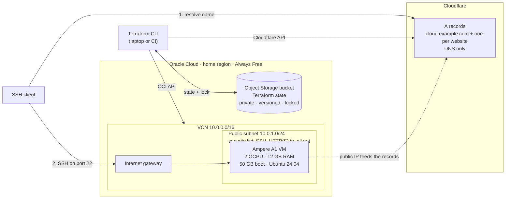

# al-laktah-cloud

[](https://github.com/al-laktah/al-laktah-cloud/actions/workflows/terraform.yml)
[](LICENSE)

My personal cloud on Oracle Cloud's **Always Free** tier, built entirely with Terraform: an Arm VM, its network, Cloudflare DNS records and remote state, at no cost.

## Architecture



- **Compute:** one Ampere A1 (Arm) VM with **2 OCPUs, 12 GB RAM and a 50 GB boot volume**, running Ubuntu 24.04.
- **Network:** a dedicated VCN and public subnet. The security list allows SSH, HTTP and HTTPS in and all traffic out, and logins are key-only: the keys in `ssh_public_keys`, YubiKey `sk-` keys included.
- **DNS:** a Cloudflare A record (`dns_name`) that follows the VM's public IP, plus one for each website in `service_dns_names`. They are DNS-only, so SSH goes straight to the VM and the websites get their HTTPS certificates on the VM itself.
- **State:** a private, versioned Object Storage bucket with automatic locking, created by a separate `bootstrap/` config.

All of it fits inside the Always Free allowance: the whole A1 allowance (2 OCPUs, 12 GB), 50 of the 200 GB of block storage, and a few KB of the 20 GB of Object Storage.

## What this project demonstrates

- **Two providers wired together.** The DNS records' content is the VM's IP, so if the VM is rebuilt, the same `apply` updates DNS.
- **Guard rails as code.** Variable validation rejects anything beyond the free tier and catches malformed IDs before any API call is made.
- **Remote state done properly.** The bucket is bootstrapped separately (the chicken-and-egg problem), versioned for recovery, locked against concurrent runs and protected with `prevent_destroy`.
- **Working around real platform limits.** OCI's API rejects FIDO2 (`sk-`) SSH keys, so keys go in via cloud-init `user_data`. `ignore_changes` stops new image releases from forcing a rebuild.
- **No secrets in git.** Credentials come from `~/.oci` and a password manager at runtime. Personal values live in git-ignored files, with committed `.example` templates.
- **CI.** Every push and pull request runs `terraform fmt` and `terraform validate`, with no cloud credentials needed.

## Files

| File | What it does |
| --- | --- |
| `versions.tf` | Pins the Terraform and provider versions |
| `backend.tf` | Stores state in OCI Object Storage (tenancy-specific settings come from `backend.hcl`) |
| `providers.tf` | Configures the OCI provider (auth from `~/.oci/config`) and the Cloudflare provider (auth from `CLOUDFLARE_API_TOKEN`) |
| `variables.tf` | Inputs, with validation that keeps you inside the free limits |
| `main.tf` | `locals`: shared derived values such as the compartment and tags |
| `network.tf` | VCN, internet gateway, route table, security list, subnet |
| `compute.tf` | Image lookup and the VM itself |
| `dns.tf` | Cloudflare A records pointing at the VM, its own and one per website (DNS only, not proxied) |
| `outputs.tf` | Values printed after `apply` (IP, hostname, SSH command) |
| `terraform.tfvars.example`, `backend.hcl.example` | Templates for your personal values |
| `bootstrap/` | A separate, run-once config that creates the state bucket |
| `.github/workflows/terraform.yml` | CI: `fmt` check and `validate` for both configs |

Personal values live only in git-ignored files: `terraform.tfvars`, `bootstrap/terraform.tfvars` and `backend.hcl`. Secrets never touch the repo: the OCI API key stays in `~/.oci`, and the Cloudflare token stays in your password manager.

## One-time setup

### 1. Install Terraform

```sh
brew tap hashicorp/tap
brew install hashicorp/tap/terraform
terraform version
```

(Plain `brew install terraform` is frozen at 1.5.7 because of the licence change, so use HashiCorp's tap.)

### 2. Create an OCI API key

Terraform signs its API calls to OCI with a key pair.

1. In the OCI Console, open the profile menu (top right), then **My profile**, then **API keys** (it may be listed as **Tokens and keys**), then **Add API key**.
2. Choose **Generate API key pair**, download the **private key** and click **Add**.
3. Move the key into place and lock down its permissions:
   ```sh
   mkdir -p ~/.oci
   mv ~/Downloads/<downloaded-key>.pem ~/.oci/oci_api_key.pem
   chmod 600 ~/.oci/oci_api_key.pem
   ```
4. The Console shows a **Configuration file preview**. Paste it into `~/.oci/config` and set `key_file`:
   ```ini
   [DEFAULT]
   user=ocid1.user.oc1..aaaa...
   fingerprint=aa:bb:cc:...
   tenancy=ocid1.tenancy.oc1..aaaa...
   region=eu-frankfurt-1
   key_file=~/.oci/oci_api_key.pem
   ```
   `region` must be your **home region**: Always Free compute can only be created there.

### 3. Create a Cloudflare API token

1. In the Cloudflare dashboard, open **My Profile**, then **API Tokens**, then **Create Token**, and use the **Edit zone DNS** template.
2. Under **Zone Resources**, choose **Include → Specific zone → your domain**, then create the token.
3. Save the token in a password manager (e.g. a 1Password API Credential item). Don't put it in any file in this repo.

### 4. Fill in your variables

```sh
cp terraform.tfvars.example terraform.tfvars
cp bootstrap/terraform.tfvars.example bootstrap/terraform.tfvars
```

- `terraform.tfvars` needs:
  - `tenancy_ocid`: the same value as `tenancy=` in `~/.oci/config`
  - `cloudflare_zone_id`: on the domain's **Overview** page, in the **API** section
  - `dns_name`
  - `ssh_public_keys`
- `bootstrap/terraform.tfvars` needs `tenancy_ocid` and `region`.

Check `ssh_public_keys` **before the first apply**: the keys are baked into the VM when it is created (see Gotchas).

### 5. Create the state bucket

Terraform can't store state in a bucket that doesn't exist yet, so `bootstrap/` creates it, using local state of its own:

```sh
cd bootstrap
terraform init
terraform apply
terraform output -raw backend_config > ../backend.hcl
cd ..
```

The bucket is private and versioned, so every past state is kept and can be restored, and `prevent_destroy` protects it from deletion. `bootstrap/terraform.tfstate` is tiny and safe to lose. If it goes missing, re-adopt the bucket with `terraform import oci_objectstorage_bucket.tfstate n/<namespace>/b/<bucket>`.

## The Terraform workflow

Load the Cloudflare token into your shell first (once per terminal session):

```sh
export CLOUDFLARE_API_TOKEN=$(op read "op://Personal/Cloudflare Terraform/credential")
```

`op://` references only allow letters, digits, `-`, `_`, `.` and spaces in vault, item and field names. If a name has anything else (e.g. parentheses), rename the item or use its ID instead (`op item list` shows IDs).

```sh
terraform init -backend-config=backend.hcl   # download providers and connect to the state bucket (commit .terraform.lock.hcl)
terraform fmt                                # format the code
terraform validate                           # check syntax and types; no API calls
terraform plan -out=tfplan                   # show what WOULD change and save it; changes nothing
terraform apply tfplan                       # make exactly the saved changes
terraform output                             # print outputs again later
terraform destroy                            # delete everything this config created (the state bucket is untouched)
```

`init` only records provider checksums for the machine it runs on. After changing a provider version (or running `init -upgrade`), record them for every platform as well, or CI on Linux will reject the lock file:

```sh
for d in . bootstrap; do
  terraform -chdir=$d providers lock -platform=darwin_arm64 -platform=darwin_amd64 -platform=linux_amd64 -platform=linux_arm64
done
```

### Moving existing local state into the bucket

If you already applied with local state (a `terraform.tfstate` in this folder), copy it into the bucket once:

```sh
terraform init -migrate-state -backend-config=backend.hcl   # answer "yes" to copy the state
terraform plan                                              # must say "No changes"
rm terraform.tfstate terraform.tfstate.backup               # the bucket is now the only copy Terraform uses
```

### Connecting

```sh
$(terraform output -raw ssh_command)
```

If your private key isn't one SSH tries by default (for example a YubiKey `sk` key handle), add `-i <private key>`, or add a host entry to `~/.ssh/config`:

```
Host oci-arm
  HostName cloud.example.com
  User ubuntu
  IdentityFile ~/.ssh/<your private key>
  IdentitiesOnly yes
```

Some useful commands for learning:

```sh
terraform state list                                # every resource Terraform is tracking
terraform state show oci_core_instance.arm_vm       # everything Terraform knows about the VM
terraform console                                   # try expressions, e.g. local.compartment_id
terraform apply -replace=oci_core_instance.arm_vm   # rebuild the VM on purpose (e.g. new image)
```

## Gotchas

- **"Out of host capacity"** means there is no free A1 capacity in that availability domain right now. Set `availability_domain_index = 1` (or `2`, if your region has 3 ADs), or retry later. Upgrading the account to Pay As You Go usually fixes this, and resources within the Always Free limits remain free.
- **Keep `availability_domain_index` matching where the VM actually is.** An instance can't move between availability domains, so changing it means destroy and recreate.
- **SSH keys are fixed at launch.** They reach the VM through cloud-init `user_data` (OCI's own `ssh_authorized_keys` field rejects YubiKey `sk-` keys), and OCI rejects changes to `user_data` after an instance starts. To add or remove a key later, edit `~/.ssh/authorized_keys` on the VM, or update `ssh_public_keys` and rebuild with `-replace`.
- **SSH is open to the whole internet**, so expect constant bot login attempts in the logs. They fail because the image allows key-only logins. To narrow access later, set `ssh_allowed_cidr`, or put the VM behind Tailscale or the OCI Bastion service.
- **Idle reclamation.** Oracle may reclaim an Always Free VM if, over 7 days, its 95th-percentile CPU, network *and* memory utilisation are all under 20%.
- **The VM has its own firewall too.** Oracle's Ubuntu images ship with restrictive `iptables` rules that allow only SSH, so ports 80 and 443 also have to be opened on the VM itself. Any other port takes both changes: a security list rule in `network.tf` *and* the VM's firewall.
- **State locking.** `plan` and `apply` hold a lock in the bucket, so two runs can't collide. If a run is killed and leaves a stale lock, the next run prints its ID; clear it with `terraform force-unlock <LOCK_ID>`. Previous state versions are under the bucket's object version history in the Console.
- **The image is chosen once.** `compute.tf` ignores newer Ubuntu images after the first apply, so they don't trigger a rebuild. Use `-replace` when you want one.

## Ideas for next steps

- A reserved public IP, so the address survives a rebuild
- `cloud-init` user data to install packages on first boot
- A separate block volume for data
- Refactor the network and VM into reusable modules
