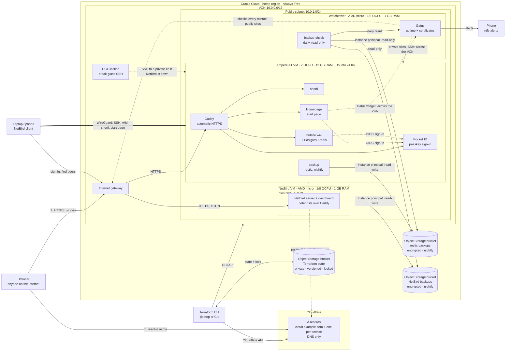

# al-laktah-cloud

[](https://github.com/al-laktah/al-laktah-cloud/actions/workflows/terraform.yml)
[](LICENSE)

My personal cloud on Oracle Cloud's **Always Free** tier, at no cost. Terraform builds the infrastructure: an Arm VM, its network, Cloudflare DNS records and remote state. The services on the VM, an Outline wiki, passkey sign-in and a start page, run as Docker Compose stacks behind Caddy and are backed up every night. A second, tiny VM watches it all from outside, and a third runs a NetBird VPN server. Only sign-in, the VPN itself and the links of a URL shortener face the internet: SSH, the wiki and everything else answer only over the VPN.

## Architecture



- **Compute:** one Ampere A1 (Arm) VM with **2 OCPUs, 12 GB RAM and a 50 GB boot volume**, running Ubuntu 24.04.
- **Network:** a dedicated VCN and public subnet. The subnet's security list lets SSH in only from inside the VCN; each VM gets just the ports it needs through network security groups: HTTPS for the two VMs that serve public sites, STUN for NetBird, and WireGuard for all three. Logins are key-only: the keys in `ssh_public_keys`, YubiKey `sk-` keys included.
- **Access:** day to day, SSH and the private sites go through NetBird. If NetBird itself is down, an OCI Bastion session reaches any VM's SSH from inside the VCN (see [Break-glass access](#break-glass-access)).
- **DNS:** a Cloudflare A record (`dns_name`) that follows the VM's public IP, plus one for each website in `service_dns_names`. They are DNS-only, so SSH goes straight to the VM and the websites get their HTTPS certificates on the VM itself.
- **State:** a private, versioned Object Storage bucket with automatic locking, created by a separate `bootstrap/` config.
- **Services:** Docker Compose stacks in [`services/`](services/README.md). They sit behind one Caddy reverse proxy that handles HTTPS for every site, and Pocket ID gives them passkey sign-in.
- **Backups:** every night, restic encrypts the services' databases and files and uploads them to a separate Object Storage bucket, keeping 7 daily, 4 weekly and 6 monthly snapshots. The VM signs in as itself, so it holds no cloud credentials.
- **Watchtower:** an Always Free AMD micro VM. Gatus checks the sites, SSH and certificates every minute and alerts your phone through ntfy. A daily job independently verifies the backups, read-only: it checks they're recent, re-reads the data and restores the databases to prove they load.
- **VPN:** the second AMD micro runs [NetBird](https://netbird.io)'s control server: sign-in, peer discovery, a relay and STUN for a WireGuard mesh. Devices connect to each other directly whenever they can. A network security group opens STUN's UDP port on that VM only. Its data is backed up nightly to a bucket of its own, and the watchtower verifies those backups too.

All of it fits inside the Always Free allowance: the whole A1 allowance (2 OCPUs, 12 GB), both AMD micro VMs, 150 of the 200 GB of block storage (three 50 GB boot volumes), and a small part of the 20 GB of Object Storage.

## What this project demonstrates

- **Two providers wired together.** The DNS records' content is the VM's IP, so if the VM is rebuilt, the same `apply` updates DNS.
- **Guard rails as code.** Variable validation rejects anything beyond the free tier and catches malformed IDs before any API call is made.
- **Remote state done properly.** The bucket is bootstrapped separately (the chicken-and-egg problem), versioned for recovery, locked against concurrent runs and protected with `prevent_destroy`.
- **Working around real platform limits.** OCI's API rejects FIDO2 (`sk-`) SSH keys, so keys go in via cloud-init `user_data`. `ignore_changes` stops new image releases from forcing a rebuild.
- **Almost nothing exposed.** Only sign-in (Pocket ID), the VPN server and shorti's short links face the internet; creating links stays private, so the shortener can't be used to spread spam. SSH and the private sites answer only to NetBird's addresses, enforced twice: by OCI's firewalls for SSH, and by Caddy for the sites. A switch in `terraform.tfvars` (`ssh_allowed_cidr`) opened SSH during the migration, and an OCI Bastion is the way in that doesn't depend on the VPN.
- **No credentials on the server.** The VM writes its backups as an OCI *instance principal*: a dynamic group plus a policy that limits it to one bucket. Nothing on the VM could leak access to anything else.
- **Backups you can restore from.** Consistent database copies (`pg_dump`, and SQLite's online backup), encrypted and deduplicated by restic, with a retention schedule, nightly integrity checks and a documented restore procedure.
- **Verification from outside.** A separate VM, with read-only access, proves daily that the backups are fresh, intact and restorable, and monitors the sites. Its own silence is caught too: by a heartbeat in Gatus, and by an external dead-man's switch.
- **Config changes that take effect.** `docker compose up -d` only recreates a container when its own definition changes, not when a config file it reads does. `deploy.sh` fingerprints each stack's files and secrets, and stacks that read config files carry the fingerprint in a label, so any change restarts them.
- **The right tool for each layer.** Terraform owns the VM, network and DNS. Docker Compose owns the apps. 1Password owns the secrets, which are injected at deploy time with `op inject` and written straight to the VM.
- **No secrets in git.** Credentials come from `~/.oci` and a password manager at runtime. Personal values live in git-ignored files, with committed `.example` templates.
- **CI.** Every push and pull request runs `terraform fmt` and `terraform validate`, checks every service stack with `docker compose config`, and lints every shell script with ShellCheck. No cloud credentials are needed.

## Files

| File | What it does |
| --- | --- |
| `versions.tf` | Pins the Terraform and provider versions |
| `backend.tf` | Stores state in OCI Object Storage (tenancy-specific settings come from `backend.hcl`) |
| `providers.tf` | Configures the OCI provider (auth from `~/.oci/config`) and the Cloudflare provider (auth from `CLOUDFLARE_API_TOKEN`) |
| `variables.tf` | Inputs, with validation that keeps you inside the free limits |
| `main.tf` | `locals`: shared derived values such as the compartment and tags |
| `network.tf` | VCN, internet gateway, route table, security list, subnet, and the shared network security groups (web, WireGuard) |
| `compute.tf` | Image and shape lookups, and the A1 VM itself |
| `dns.tf` | Cloudflare A records pointing at the VM, its own and one per website (DNS only, not proxied) |
| `watchtower.tf` | The watchtower VM (Always Free AMD micro), and the network security group that lets only the main VM read Gatus |
| `netbird.tf` | The NetBird VPN server (the second AMD micro), with its own network security group for STUN |
| `bastion.tf` | The OCI Bastion, for break-glass SSH when NetBird is down |
| `backup.tf` | Dynamic groups and policies: the main VM and the NetBird VM may each write to their own backups bucket, and the watchtower may only read them |
| `outputs.tf` | Values printed after `apply`: IPs and hostnames, the VMs' private IPs, the bastion's ID and the settings for `services/config.env` |
| `terraform.tfvars.example`, `backend.hcl.example`, `terraform.env.example` | Templates for your personal values |
| `bootstrap/` | A separate config for the long-lived buckets, Terraform state and backups, that must outlive the VM |
| `host/setup-vm.sh` | Prepares a VM itself: updates, its own firewall, Docker, log rotation, and joining NetBird |
| `services/` | Docker Compose stacks (Caddy, Pocket ID, Outline, Homepage, backups, the watchtower's Gatus and backup checks, and NetBird) and `deploy.sh`. See [services/README.md](services/README.md) |
| `.github/workflows/terraform.yml` | CI: `fmt` and `validate` for both Terraform configs, `docker compose config` for every stack, and ShellCheck for every script |

Personal values live only in git-ignored files: `terraform.tfvars`, `bootstrap/terraform.tfvars`, `backend.hcl` and `terraform.env`. Secrets never touch the repo: the OCI API key stays in `~/.oci`, and the Cloudflare token stays in your password manager.

## One-time setup

### 1. Install Terraform

```sh
brew tap hashicorp/tap
brew install hashicorp/tap/terraform
terraform version
```

(Plain `brew install terraform` is frozen at 1.5.7 because of the licence change, so use HashiCorp's tap.)

### 2. Create an OCI API key

Terraform signs its API calls to OCI with a key pair.

1. In the OCI Console, open the profile menu (top right), then **My profile**, then **API keys** (it may be listed as **Tokens and keys**), then **Add API key**.
2. Choose **Generate API key pair**, download the **private key** and click **Add**.
3. Move the key into place and lock down its permissions:
   ```sh
   mkdir -p ~/.oci
   mv ~/Downloads/<downloaded-key>.pem ~/.oci/oci_api_key.pem
   chmod 600 ~/.oci/oci_api_key.pem
   ```
4. The Console shows a **Configuration file preview**. Paste it into `~/.oci/config` and set `key_file`:
   ```ini
   [DEFAULT]
   user=ocid1.user.oc1..aaaa...
   fingerprint=aa:bb:cc:...
   tenancy=ocid1.tenancy.oc1..aaaa...
   region=eu-frankfurt-1
   key_file=~/.oci/oci_api_key.pem
   ```
   `region` must be your **home region**: Always Free compute can only be created there.

### 3. Create a Cloudflare API token

1. In the Cloudflare dashboard, open **My Profile**, then **API Tokens**, then **Create Token**, and use the **Edit zone DNS** template.
2. Under **Zone Resources**, choose **Include → Specific zone → your domain**, then create the token.
3. Save the token in a password manager (e.g. a 1Password API Credential item). Don't put it in any file in this repo.

### 4. Fill in your variables

```sh
cp terraform.tfvars.example terraform.tfvars
cp bootstrap/terraform.tfvars.example bootstrap/terraform.tfvars
cp terraform.env.example terraform.env
```

- `terraform.tfvars` needs:
  - `tenancy_ocid`: the same value as `tenancy=` in `~/.oci/config`
  - `cloudflare_zone_id`: on the domain's **Overview** page, in the **API** section
  - `dns_name`, `watchtower_dns_name` and `netbird_dns_name`
  - `ssh_public_keys`
- `bootstrap/terraform.tfvars` needs `tenancy_ocid` and `region`.
- `terraform.env` needs the 1Password reference to your Cloudflare token (see [The Terraform workflow](#the-terraform-workflow)).

Check `ssh_public_keys` **before the first apply**: the keys are baked into the VM when it is created (see Gotchas).

### 5. Create the state bucket

Terraform can't store state in a bucket that doesn't exist yet, so `bootstrap/` creates it, using local state of its own:

```sh
cd bootstrap
terraform init
terraform apply
terraform output -raw backend_config > ../backend.hcl
cd ..
```

The bucket is private and versioned, so every past state is kept and can be restored, and `prevent_destroy` protects it from deletion. `bootstrap/terraform.tfstate` is tiny and safe to lose. If it goes missing, re-adopt the bucket with `terraform import oci_objectstorage_bucket.tfstate n/<namespace>/b/<bucket>`.

## The Terraform workflow

`plan`, `apply` and `destroy` talk to Cloudflare, so they need the token in `CLOUDFLARE_API_TOKEN`. Instead of exporting it into your shell, let 1Password hand it to each command:

```sh
op run --env-file=terraform.env -- terraform plan -out=tfplan
```

`terraform.env` holds only a reference (`CLOUDFLARE_API_TOKEN="op://vault/item/field"`). `op run` looks it up, runs the command with the token in its environment, and masks the token if it ever shows up in the output. The token is never stored in your shell, so a new terminal can't silently be missing it. If 1Password is locked or the reference is wrong, `op run` stops with an error instead of starting Terraform without a token.

To save typing, add `alias tf='op run --env-file=terraform.env -- terraform'` to your shell profile and run `tf plan`, `tf apply`. Only the repo root needs it, since `bootstrap/` doesn't use Cloudflare.

`op://` references only allow letters, digits, `-`, `_`, `.` and spaces in vault, item and field names. If a name has anything else (e.g. parentheses), rename the item or use its ID instead (`op item list` shows IDs).

```sh
terraform init -backend-config=backend.hcl   # download providers and connect to the state bucket (commit .terraform.lock.hcl)
terraform fmt                                # format the code
terraform validate                           # check syntax and types; no API calls
terraform plan -out=tfplan                   # show what WOULD change and save it; changes nothing
terraform apply tfplan                       # make exactly the saved changes
terraform output                             # print outputs again later
terraform destroy                            # delete everything this config created (the state bucket is untouched)
```

`init` only records provider checksums for the machine it runs on. After changing a provider version (or running `init -upgrade`), record them for every platform as well, or CI on Linux will reject the lock file:

```sh
for d in . bootstrap; do
  terraform -chdir=$d providers lock -platform=darwin_arm64 -platform=darwin_amd64 -platform=linux_amd64 -platform=linux_arm64
done
```

### Moving existing local state into the bucket

If you already applied with local state (a `terraform.tfstate` in this folder), copy it into the bucket once:

```sh
terraform init -migrate-state -backend-config=backend.hcl   # answer "yes" to copy the state
terraform plan                                              # must say "No changes"
rm terraform.tfstate terraform.tfstate.backup               # the bucket is now the only copy Terraform uses
```

### Connecting

```sh
$(terraform output -raw ssh_command)
```

If your private key isn't one SSH tries by default (for example a YubiKey `sk` key handle), add `-i <private key>`, or add a host entry to `~/.ssh/config`:

```
Host oci-arm
  HostName cloud.example.com
  User ubuntu
  IdentityFile ~/.ssh/<your private key>
  IdentitiesOnly yes
```

Some useful commands for learning:

```sh
terraform state list                                # every resource Terraform is tracking
terraform state show oci_core_instance.arm_vm       # everything Terraform knows about the VM
terraform console                                   # try expressions, e.g. local.compartment_id
terraform apply -replace=oci_core_instance.arm_vm   # rebuild the VM on purpose (e.g. new image)
```

## Gotchas

- **"Out of host capacity"** means there is no free A1 capacity in that availability domain right now. Set `availability_domain_index = 1` (or `2`, if your region has 3 ADs), or retry later. Upgrading the account to Pay As You Go usually fixes this, and resources within the Always Free limits remain free.
- **Keep `availability_domain_index` matching where the VM actually is.** An instance can't move between availability domains, so changing it means destroy and recreate.
- **SSH keys are fixed at launch.** They reach the VM through cloud-init `user_data` (OCI's own `ssh_authorized_keys` field rejects YubiKey `sk-` keys), and OCI rejects changes to `user_data` after an instance starts. To add or remove a key later, edit `~/.ssh/authorized_keys` on the VM, or update `ssh_public_keys` and rebuild with `-replace`.
- **SSH answers only inside the VCN.** From your laptop, SSH goes through NetBird; if NetBird is down, use the Bastion (below). To open SSH to the internet again, for example on a fresh setup before NetBird runs, set `ssh_allowed_cidr = "0.0.0.0/0"`.
- **Idle reclamation.** Oracle may reclaim an Always Free VM if, over 7 days, its 95th-percentile CPU, network *and* memory utilisation are all under 20%.
- **The VM has its own firewall too.** Oracle's Ubuntu images ship with restrictive `iptables` rules that allow only SSH, so ports 80 and 443 also have to be opened on the VM itself (`host/setup-vm.sh` does that). Any other port takes both changes: a rule in OCI (the subnet's security list in `network.tf`, or a VM's own network security group like the one in `netbird.tf`) *and* the VM's firewall.
- **State locking.** `plan` and `apply` hold a lock in the bucket, so two runs can't collide. If a run is killed and leaves a stale lock, the next run prints its ID; clear it with `terraform force-unlock <LOCK_ID>`. Previous state versions are under the bucket's object version history in the Console.
- **The image is chosen once.** `compute.tf` ignores newer Ubuntu images after the first apply, so they don't trigger a rebuild. Use `-replace` when you want one.

## Break-glass access

If NetBird is down, SSH to a VM through the OCI Bastion instead. A session lasts up to 3 hours and only accepts the public key it was created with (an Ed25519 or RSA key; not a YubiKey `sk-` key).

1. In the OCI Console, open **Identity & Security → Bastion → breakglass → Create session**:
   - **Session type:** SSH port forwarding session
   - **Connect to the target host by using:** IP address, with the VM's private IP from `terraform output private_ips`, port 22
   - **SSH key:** paste your public key
2. When the session is active, open its **⋮ → Copy SSH command**. It looks like this:
   ```sh
   ssh -i <private key> -N -L 2222:<private IP>:22 -p 22 <session OCID>@host.bastion.<region>.oci.oraclecloud.com
   ```
   For a key held by an agent (such as 1Password), use the `.pub` file as `-i` and add `-o IdentitiesOnly=yes`.
3. Leave that running, and connect through the tunnel in a second terminal: `ssh -p 2222 ubuntu@localhost`.

With the OCI CLI, `oci bastion session create-port-forwarding --bastion-id "$(terraform output -raw bastion_id)" --target-private-ip <private IP> --target-port 22 --ssh-public-key-file <key>.pub` creates the session instead.

## Ideas for next steps

- A reserved public IP, so the address survives a rebuild
- `cloud-init` user data to install packages on first boot
- A separate block volume for data
- Refactor the network and VM into reusable modules
